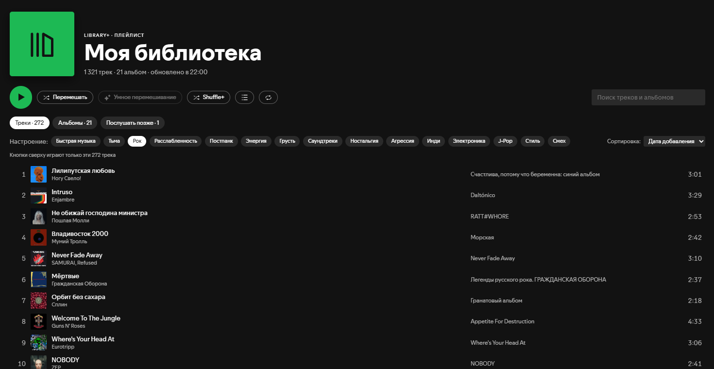

# Library+ for Spicetify

Your whole Spotify library as one playlist.



## What it does

- **«My Library» playlist.** A real private playlist that Library+ keeps in sync with your Liked Songs + saved albums (newest first). It updates when Spotify starts and on every like or album save, including ones from your phone while the desktop app is running. Spotify's own play, shuffle, Smart Shuffle and search work on it. So does [Shuffle+](https://github.com/spicetify/cli/blob/main/Extensions/shuffle%2B.js)'s “Play with Shuffle+”.
- **Library+ page** (icon in the top bar):
  - play in order, Shuffle, Smart Shuffle, Shuffle+ (true random);
  - search across tracks and albums;
  - **mood filters**: Spotify's Liked Songs chips (Rock, Chill, Sad…) applied to the whole library. Spotify gives these chips only to some accounts; when it gives none, Library+ tries its own set of about 40 moods and genres on your library and shows the 15 that fit most tracks;
  - sorting by date added, title, artist, album or duration (albums: date added, title or artist). Sorting is remembered;
  - the × on a track row takes it out of My Library (the like and the album stay). Tracks you delete from the playlist in Spotify itself stay out too, instead of coming back at the next sync. They show up in a **Removed** tab, grouped by album like the Albums tab; open an album to see and bring back just the tracks removed from it;
  - **No Liked Songs** toggle: hides your liked tracks and skips them on every tab, so you hear only what you haven't liked yet. It stays on until you switch it off;
  - right-click a track or album for Spotify's own menu.

  The buttons play what the open tab shows: the library, the filtered or sorted list, or the albums on a shelf. Smart Shuffle works everywhere too. A list that isn't a whole playlist is written into a third private playlist, “Library+ · Now Playing”, and played from there. Library+ pins it after your own pins and gives it a fixed cover, so it doesn't jump around the sidebar.
- **Album shelves.** “Albums” = your saved albums; their tracks are part of the library. “Listen later” = albums put aside for later. They are not played with the library and live in a second private playlist, so you see them on your phone too. Albums are shown as Spotify-style tiles: click to open, right-click for the menu.

The interface is in English or Russian, depending on Spotify's language.

## Install

Custom apps can't be installed from Marketplace with one click, so:

**Windows** (PowerShell):

```powershell
iwr -useb https://raw.githubusercontent.com/overbacon/spicetify-library-plus/main/install.ps1 | iex
```

**macOS / Linux / manual**: download this repo, then copy the `library-plus` folder into Spicetify's `CustomApps` folder. That folder sits next to the file `spicetify -c` prints. Then run:

```sh
spicetify config custom_apps library-plus
spicetify apply
```

**Uninstall**: `spicetify config custom_apps library-plus-`, then `spicetify apply`. Delete the folder and, if you like, the three playlists.

## Notes

- Local files from Liked Songs are skipped.
- Library+ manages the playlist's contents. Tracks you add by hand are removed at the next sync; tracks you remove stay removed (see “Removed: N”). Reordering is kept.
- Requires Spicetify 2.x on a recent Spotify desktop client. Tested on Spotify 1.3.4 and 1.3.6 with Spicetify 2.45 and 2.46.

## Development

`powershell -File install.ps1` from a clone links the folder into Spicetify. Edits then apply after `spicetify apply`. Run the test with `node --test test/plan.test.mjs`.

---

**По-русски.** Вся библиотека как один закрытый плейлист «Моя библиотека» (лайки + сохранённые альбомы, синхронизируется сам). На странице Library+ есть:
- кнопки: по порядку / перемешать / умное перемешивание / Shuffle+ — играют то, что открыто во вкладке;
- поиск, фильтры настроений, сортировка, родное меню по правому клику;
- переключатель «Без любимых»: лайкнутые треки скрыты и не играют ни на одной вкладке;
- альбомы плитками, как в Spotify, с сортировкой; крестик в строке убирает трек из «Моей библиотеки», удалённые прямо в Spotify тоже не возвращаются, а вернуть их можно на вкладке «Убранные» (по альбомам);
- полки альбомов «Альбомы» и «Послушать позже».

Установка на Windows — команда выше.
